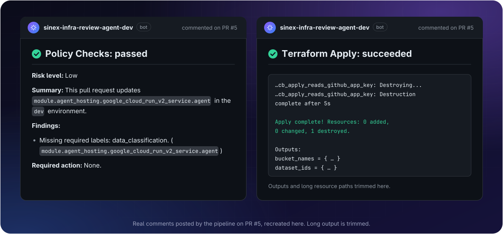

<p align="center"></p>

<p align="center"><a href="https://github.com/sinex-cloud/infrastructure-terraform-gcp/actions/workflows/ci.yml"></a></p>

**Deterministic checks decide pass or fail. The AI only explains. A human approves the apply.**

## How it works

<p align="center"></p>

## Try the policy checker

No GCP needed. This is the real script, run on the example plans in [`examples/`](examples/).

<p align="center"></p>

```bash
python3 scripts/policy_checks.py examples/risky-change/plan.json
python3 scripts/policy_checks.py examples/valid-change/plan.json
```

## What it posts on the pull request

<p align="center"></p>

See them live on [PR #5](https://github.com/sinex-cloud/infrastructure-terraform-gcp/pull/5). The demo project ran on a Google Cloud free trial and is no longer live.

## Design

| Document | Covers |
|---|---|
| [`docs/technical_design.md`](docs/technical_design.md) | Architecture, pipelines, known limitations |
| [`docs/github_app_design.md`](docs/github_app_design.md) | GitHub App permissions and auth flow |
| [`docs/apply_workflow.md`](docs/apply_workflow.md) | Apply pipeline and approval step |
| [`examples/README.md`](examples/README.md) | Step-by-step demo scenario |

Uses reusable modules from [`gcp-foundation-module`](https://github.com/sinex-cloud/gcp-foundation-module), pinned by git tag.

<details>
<summary><b>Setup and deployment</b></summary>

You need Terraform, `gcloud`, a GCP project with a deployment service account named `sa-tf-deployer-<env>` and a GCS bucket for state that matches `environments/<env>.tfbackend`. Terraform impersonates the service account (see `provider.tf`), so no key files are involved. `versions.tf` requires Terraform 1.3.0 or newer, and the pipelines use 1.15.8.

```bash
terraform init -backend-config=environments/dev.tfbackend
terraform plan -var-file=environments/dev.tfvars
terraform apply -var-file=environments/dev.tfvars
```

In practice these commands run through Cloud Build (`cloudbuild/review.cloudbuild.yaml` and `cloudbuild/apply.cloudbuild.yaml`), not by hand.

### GitHub App

The App (`sinex-infra-review-agent-dev`) is created once by hand in the GitHub settings. Terraform does not manage it. The permissions are `Contents: read`, `Pull requests: read & write` and `Metadata: read`, and it subscribes to the `Pull request` webhook event. The details are in [`docs/github_app_design.md`](docs/github_app_design.md). After creating it:

1. Install the App on the target repo.
2. Store its webhook secret and private key in Secret Manager as `infra-agent-github-webhook-secret-dev` and `infra-agent-github-app-key-dev`. Terraform creates both as empty secrets (`gcp-foundation-module/agent-hosting/secrets.tf`). You add the values by hand, so they never appear in Terraform state.
3. Point the App's webhook URL at the `/webhook/github` path of the deployed Cloud Run service.

### Cloud Run

`agent-hosting/agent.tf` creates the Cloud Run service but ignores changes to its container image (`lifecycle.ignore_changes`). Terraform sets up the environment variables, secret mounts and IAM. The image is built and deployed separately, so Terraform never reverts a manual deploy:

```bash
cd agent-service
gcloud builds submit --tag <region>-docker.pkg.dev/<project>/infra-agent-images-dev/agent:<tag>
gcloud run deploy infra-review-agent-dev --image <region>-docker.pkg.dev/<project>/infra-agent-images-dev/agent:<tag>
```

### Cloud Build

Cloud Build reaches this repo through a Developer Connect connection (`agent-hosting/cloudbuild_connection.tf`). The connection only fetches source. It is separate from the GitHub App, which posts the comments. The agent service starts builds directly through the Cloud Build API (`POST .../builds`) instead of using a `BuildTrigger`. That way the pipeline YAML comes from the exact commit of the PR.

### Local development

The agent service is a plain FastAPI app. At request time its only GCP dependency is the metadata server, which it uses to mint tokens.

```bash
cd agent-service
pip install -r requirements.txt
uvicorn app.main:app --reload
```

The scripts in `scripts/` need only `PyYAML` and the standard library.

</details>

## Adding a dataset, bucket or IAM permission

The data platform is driven by `foundation-config/foundation.yaml`, so routine changes need no `.tf` edits:

```yaml
managed_datasets:
  my_new_dataset:
    location: europe-west1
    environments: [dev, int]
    permissions:
      - role: bigquery.dataViewer
        members:
          users: [someone@example.com]

buckets:
  my-new-bucket:
    location: europe-west1
    environments: [dev]
    permissions:
      - role: storage.objectViewer
        members:
          users: [someone@example.com]

additional_project_permissions:
  - role: bigquery.jobUser
    environments: [dev]
    members:
      users: [someone@example.com]
```

Open a PR with the change. The review pipeline plans it, runs the policy checks and posts the review before anyone approves the apply.

## Running the tests

CI runs these tests, plus `terraform fmt` and `terraform validate`, on every push and pull request. To run the tests locally, note that the agent service tests import `app`, so they have to run from inside `agent-service/` with `python -m pytest`:

```bash
pip install -r agent-service/requirements.txt pytest
python -m pytest scripts/
cd agent-service && python -m pytest app/
```

## Known limitations

- `int` is configured (`environments/int.tfvars`) but never applied. Dev is the only environment that is deployed.
- The apply trigger trusts the `approved-for-apply` label and does not check `pull_request.merged`. The label is only added after a merge in practice, but nothing in the code enforces it.
- `terraform-apply` makes its own fresh plan. It does not apply the exact plan a person reviewed, so state could change between review and approval.
- `policy_checks.py` does not catch raw YAML syntax errors in `foundation.yaml`. `terraform plan` fails on those before the script runs.

The full list, with the reasoning, is in the Known Limitations section of [`docs/technical_design.md`](docs/technical_design.md).
